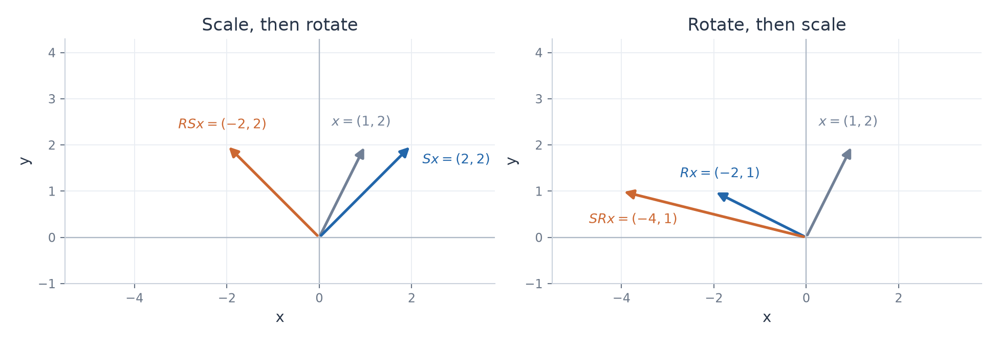
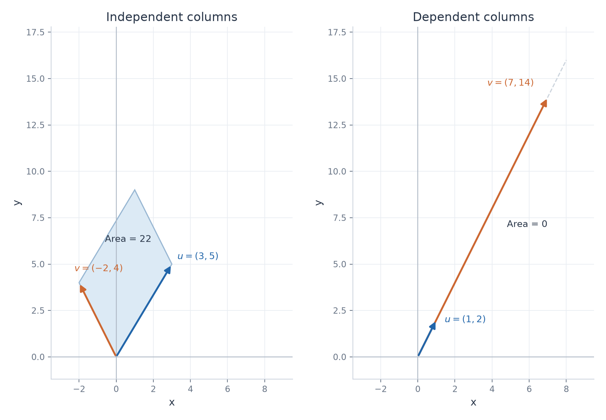

# Matrices and Determinants

Twenty worked exercises with complete problem statements, solution steps, and mathematical checks. The scope is matrix exercises 1–15 and determinant exercises 1–5.

## Matrices and basic operations

| Exercise | Main idea to explain |
| --- | --- |
| [1. Matrix size and entries](../solutions/1_Algebra/01_matrices_and_operations/problem_01_solution.md) | An index selects a row and then a column. |
| [2. Addition and scalar multiplication](../solutions/1_Algebra/01_matrices_and_operations/problem_02_solution.md) | Corresponding entries are combined, so the sizes must match. |
| [3. Multiplication dimensions](../solutions/1_Algebra/01_matrices_and_operations/problem_03_solution.md) | The inner dimensions must agree, and the outer dimensions give the resulting size. |
| [4. Noncommutativity](../solutions/1_Algebra/01_matrices_and_operations/problem_04_solution.md) | Changing the order of matrix factors can change the result. |
| [5. Matrix times vector](../solutions/1_Algebra/01_matrices_and_operations/problem_05_solution.md) | The entries of the vector weight the columns of the matrix. |
| [6. Transpose](../solutions/1_Algebra/01_matrices_and_operations/problem_06_solution.md) | Transposition exchanges rows and columns and reverses the order of a product. |
| [7. Identity, zero, and powers](../solutions/1_Algebra/01_matrices_and_operations/problem_07_solution.md) | Identify the neutral elements and the pattern in repeated multiplication. |
| [8. Reversible row operations](../solutions/1_Algebra/01_matrices_and_operations/problem_08_solution.md) | Undo row operations in reverse order to recover the original matrix. |
| [9. Composing transformations](../solutions/1_Algebra/01_matrices_and_operations/problem_09_solution.md) | Read a product from right to left. The order of scaling and rotation matters. |
| [10. Columns of a product](../solutions/1_Algebra/01_matrices_and_operations/problem_10_solution.md) | Each column of the product is the image of a column of the right factor. |
| [11. Commuting matrices](../solutions/1_Algebra/01_matrices_and_operations/problem_11_solution.md) | Equating corresponding entries gives necessary and sufficient conditions. |
| [12. A formula for a matrix power](../solutions/1_Algebra/01_matrices_and_operations/problem_12_solution.md) | An induction step proves the observed pattern for every positive integer. |
| [13. A recurrence in matrix form](../solutions/1_Algebra/01_matrices_and_operations/problem_13_solution.md) | The matrix creates a new sum and retains one previous term. |
| [14. Rotation matrices](../solutions/1_Algebra/01_matrices_and_operations/problem_14_solution.md) | Two rotations about the origin add their angles. |
| [15. Associativity](../solutions/1_Algebra/01_matrices_and_operations/problem_15_solution.md) | Parentheses can change the calculation cost while preserving the result. |

## Determinants

| Exercise | Main idea to explain |
| --- | --- |
| [1. A 2×2 determinant](../solutions/1_Algebra/02_determinants/problem_01_solution.md) | A nonzero determinant gives invertibility. Its absolute value gives a parallelogram area. |
| [2. A 3×3 determinant](../solutions/1_Algebra/02_determinants/problem_02_solution.md) | Sarrus' rule gives 33, and a row operation provides an independent check. |
| [3. Swapping rows](../solutions/1_Algebra/02_determinants/problem_03_solution.md) | One row swap reverses the sign of the determinant. |
| [4. A triangular matrix](../solutions/1_Algebra/02_determinants/problem_04_solution.md) | Multiply the diagonal entries to obtain the determinant. |
| [5. Row operations](../solutions/1_Algebra/02_determinants/problem_05_solution.md) | Track how each operation affects the determinant before using the triangular form. |

## Visual examples

### The order of transformations

The horizontal scaling acts along a fixed coordinate axis. Changing its position in the composition changes the final vector. The full calculation is in matrix exercise 9.

### Determinant and area

Independent columns span a parallelogram with nonzero area. When the columns are dependent, the parallelogram collapses to a line. The calculations and inverse check are in determinant exercise 1.
