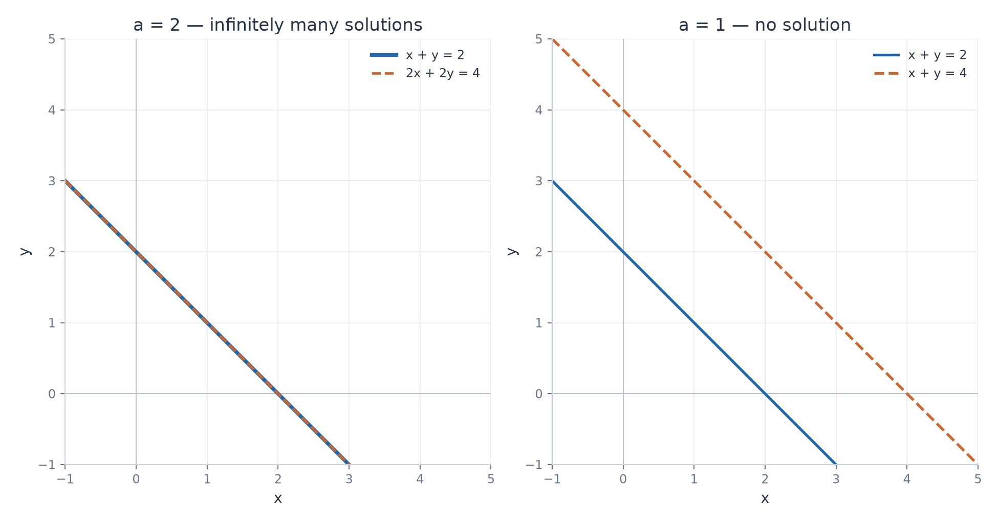
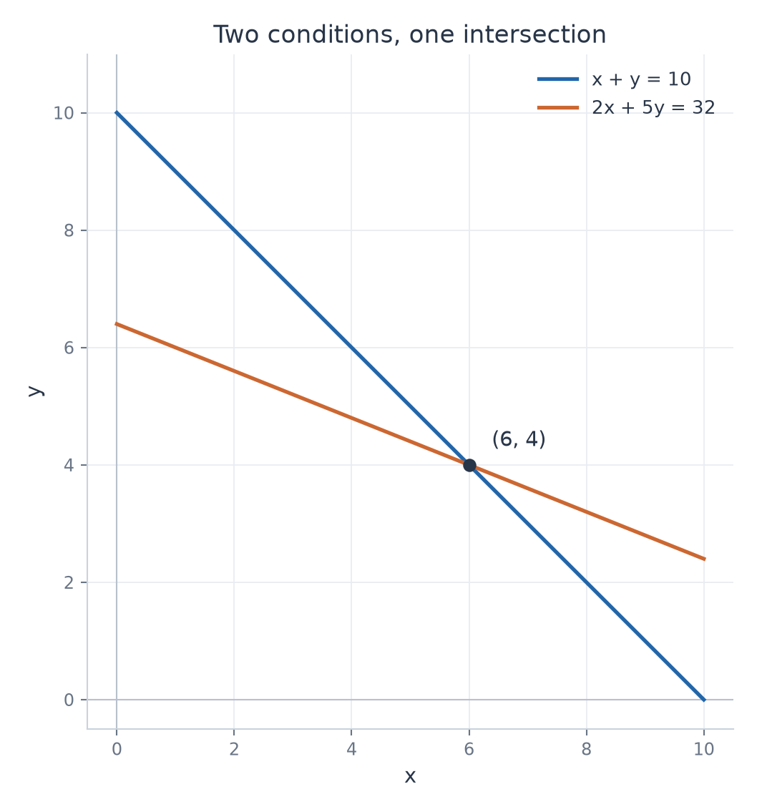
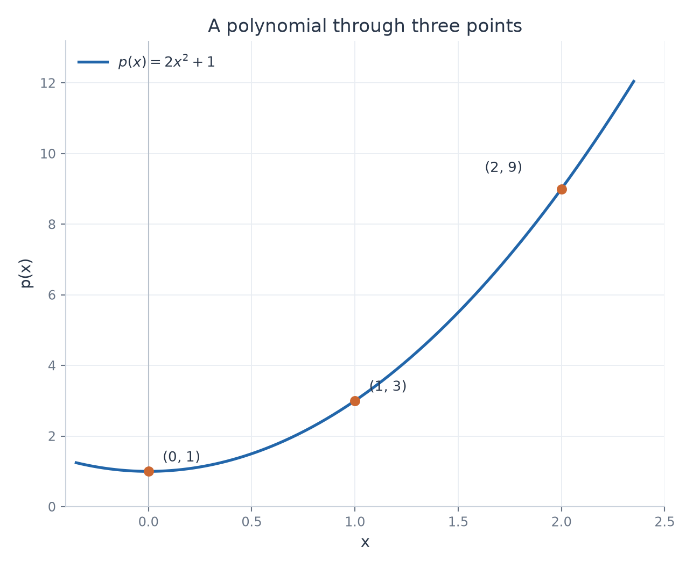

# Systems of Linear Equations

Worked solutions for exercises 1–15. Each solution includes the original problem, a method, calculation steps, and a mathematical check.

| Exercise | Main idea to explain |
| --- | --- |
| [1. From equations to a matrix](../solutions/1_Algebra/04_systems_of_equations/problem_01_solution.md) | Keep the unknowns in the same order in every row. |
| [2. One solution](../solutions/1_Algebra/04_systems_of_equations/problem_02_solution.md) | Three pivots determine the three unknowns. |
| [3. An inconsistent system](../solutions/1_Algebra/04_systems_of_equations/problem_03_solution.md) | A row representing $0=1$ rules out every candidate. |
| [4. Infinitely many solutions](../solutions/1_Algebra/04_systems_of_equations/problem_04_solution.md) | A free variable parameterizes a line of solutions. |
| [5. Reading echelon form](../solutions/1_Algebra/04_systems_of_equations/problem_05_solution.md) | Three unknowns and two pivots give one free variable. |
| [6. A parameter](../solutions/1_Algebra/04_systems_of_equations/problem_06_solution.md) | The last row is consistent only for $a=2$. |
| [7. Choosing a method](../solutions/1_Algebra/04_systems_of_equations/problem_07_solution.md) | Use the matrix structure and the information already supplied. |
| [8. Reusing elimination](../solutions/1_Algebra/04_systems_of_equations/problem_08_solution.md) | The same coefficient matrix gives the same elimination operations. |
| [9. Two intersecting lines](../solutions/1_Algebra/04_systems_of_equations/problem_09_solution.md) | Different slopes give the unique intersection $(6,4)$. |
| [10. Finding a polynomial](../solutions/1_Algebra/04_systems_of_equations/problem_10_solution.md) | Point conditions produce a linear system for the coefficients. |
| [11. A parameter in three equations](../solutions/1_Algebra/04_systems_of_equations/problem_11_solution.md) | Check $t=1$ before dividing by $t-1$; the exceptional case is inconsistent. |
| [12. A homogeneous system](../solutions/1_Algebra/04_systems_of_equations/problem_12_solution.md) | The free variable gives $(-s,s,s)$, including the zero solution. |
| [13. A redundant equation](../solutions/1_Algebra/04_systems_of_equations/problem_13_solution.md) | Subtracting the second equation from the first gives the third. |
| [14. A changed right-hand side](../solutions/1_Algebra/04_systems_of_equations/problem_14_solution.md) | Changing $3$ to $3.1$ turns a redundant equation into a contradiction. |
| [15. Classifying three systems](../solutions/1_Algebra/04_systems_of_equations/problem_15_solution.md) | Stop elimination once pivots or a contradictory row determine the type. |

## A parameter changes consistency

For $a=2$, both equations describe the same line. For $a\ne2$, elimination produces a contradiction. No value of $a$ gives a unique solution in this problem.

## A unique solution as an intersection

The marked point satisfies both conditions. The two slopes are different, so there is exactly one intersection.

## From point conditions to a polynomial

The system determines $a=2$, $b=0$, and $c=1$. Substitution of $x=0,1,2$ checks each given point.
