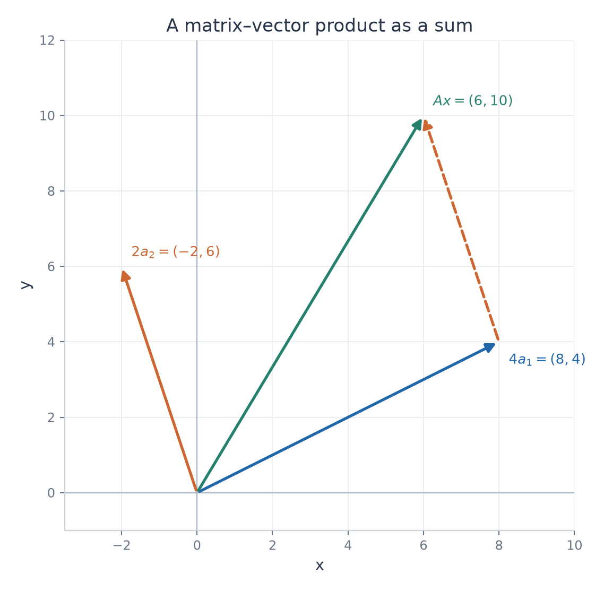

# Exercise 5 — Matrix Times Vector

[Exercise sheet](../../../exercises/1_Algebra/01_matrices_and_operations_en.md)

## Problem

Let

$$
A=
\begin{pmatrix}
2 & -1 \\
1 & 3 \\
\end{pmatrix},\qquad x=
\begin{pmatrix}
4 \\
2 \\
\end{pmatrix}.
$$

Compute $Ax$. Then express $Ax$ as a linear combination of the columns of $A$, with coefficients coming from the vector $x$.

## Method

Use row–column multiplication, then check the result as a weighted sum of the columns of $A$.

## Solution

**Row–column calculation**

$$
Ax=\begin{pmatrix}
2\cdot4+(-1)\cdot2 \\
1\cdot4+3\cdot2 \\
\end{pmatrix}=\begin{pmatrix}
6 \\
10 \\
\end{pmatrix}.
$$

**Column interpretation**

The coefficients $4$ and $2$ are the entries of $x$.

$$
Ax=4\begin{pmatrix}
2 \\
1 \\
\end{pmatrix}+2\begin{pmatrix}
-1 \\
3 \\
\end{pmatrix}=\begin{pmatrix}
8 \\
4 \\
\end{pmatrix}+\begin{pmatrix}
-2 \\
6 \\
\end{pmatrix}=\begin{pmatrix}
6 \\
10 \\
\end{pmatrix}.
$$

**Result**

$$
Ax=\begin{pmatrix}
6 \\
10 \\
\end{pmatrix}.
$$

The dashed translated vector completes the sum. The endpoint is $(6,10)$.

## Verification

Recover the first weighted column by subtracting the second weighted column from the result.

$$
\begin{pmatrix}
6 \\
10 \\
\end{pmatrix}-\begin{pmatrix}
-2 \\
6 \\
\end{pmatrix}=\begin{pmatrix}
8 \\
4 \\
\end{pmatrix}=4\begin{pmatrix}
2 \\
1 \\
\end{pmatrix}.
$$

This agrees with both calculations.
