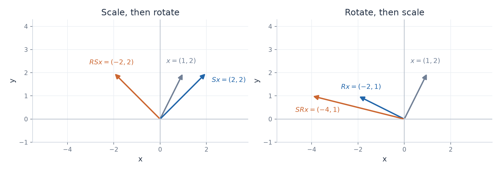

# Exercise 9 — Composing Transformations

[Exercise sheet](../../../exercises/1_Algebra/01_matrices_and_operations_en.md)

## Problem

Let

$$
S=
\begin{pmatrix}
2 & 0 \\
0 & 1 \\
\end{pmatrix},\qquad R=
\begin{pmatrix}
0 & -1 \\
1 & 0 \\
\end{pmatrix}.
$$

The matrix $S$ describes nonuniform scaling, while $R$ describes a $90^\circ$ counterclockwise rotation.
For

$$
x=
\begin{pmatrix}
1 \\
2 \\
\end{pmatrix}
$$

compute $RSx$ and $SRx$. Compare the results and explain geometrically why the order of these transformations matters.

## Method

Matrix products act from right to left. For $RSx$, first scale and then rotate. For $SRx$, first rotate and then scale.

## Solution

**Scale, then rotate**

$$
Sx=\begin{pmatrix}
2 \\
2 \\
\end{pmatrix},\qquad RSx=R\begin{pmatrix}
2 \\
2 \\
\end{pmatrix}=\begin{pmatrix}
-2 \\
2 \\
\end{pmatrix}.
$$

**Rotate, then scale**

$$
Rx=\begin{pmatrix}
-2 \\
1 \\
\end{pmatrix},\qquad SRx=S\begin{pmatrix}
-2 \\
1 \\
\end{pmatrix}=\begin{pmatrix}
-4 \\
1 \\
\end{pmatrix}.
$$

**Result**

$$
RSx=\begin{pmatrix}
-2 \\
2 \\
\end{pmatrix},\qquad SRx=\begin{pmatrix}
-4 \\
1 \\
\end{pmatrix},\qquad RSx\ne SRx.
$$

The scaling $S$ doubles the horizontal coordinate. A rotation changes which direction is horizontal relative to the original vector. Applying this nonuniform scaling before or after the rotation therefore produces different vectors.

Both panels use the same scale. Gray shows the original vector, blue the intermediate vector, and orange the final vector.

## Verification

The composite matrices give the same results directly.

$$
RS=\begin{pmatrix}
0 & -1 \\
2 & 0 \\
\end{pmatrix},\qquad SR=\begin{pmatrix}
0 & -2 \\
1 & 0 \\
\end{pmatrix}.
$$

$$
(RS)\begin{pmatrix}
1 \\
2 \\
\end{pmatrix}=\begin{pmatrix}
-2 \\
2 \\
\end{pmatrix},\qquad (SR)\begin{pmatrix}
1 \\
2 \\
\end{pmatrix}=\begin{pmatrix}
-4 \\
1 \\
\end{pmatrix}.
$$
