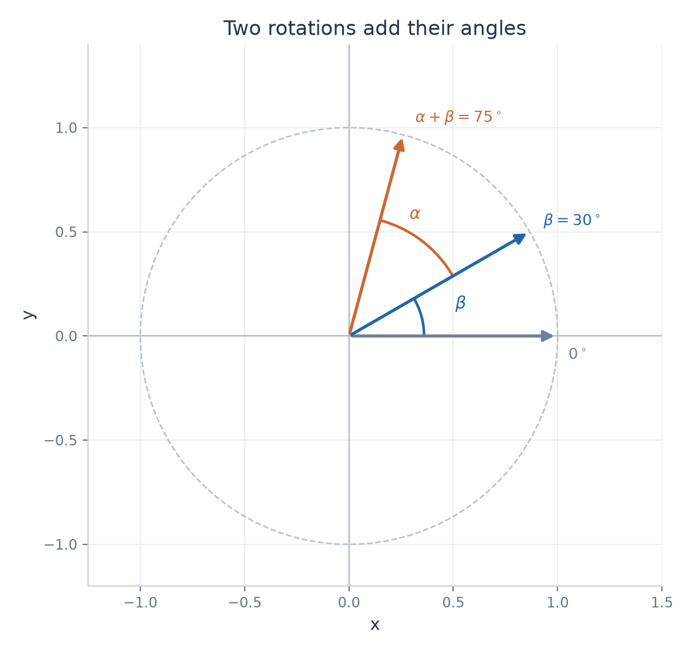

# Exercise 14 — Rotation Matrices

[Exercise sheet](../../../exercises/1_Algebra/01_matrices_and_operations_en.md)

## Problem

The matrix for a rotation through an angle $\theta$ is

$$
R(\theta)=
\begin{pmatrix}
\cos\theta & -\sin\theta \\
\sin\theta & \cos\theta \\
\end{pmatrix}.
$$

Compute $R(\alpha)R(\beta)$ and, using the angle-sum formulas for sine and cosine, show that

$$
R(\alpha)R(\beta)=R(\alpha+\beta).
$$

Explain the result geometrically.

## Method

Multiply the two rotation matrices and simplify each entry with the sine and cosine angle-sum identities.

## Solution

**Matrix product**

$$
R(\alpha)R(\beta)=\begin{pmatrix}
\cos\alpha\cos\beta-\sin\alpha\sin\beta & -\cos\alpha\sin\beta-\sin\alpha\cos\beta \\
\sin\alpha\cos\beta+\cos\alpha\sin\beta & -\sin\alpha\sin\beta+\cos\alpha\cos\beta \\
\end{pmatrix}.
$$

**Angle-sum identities**

$$
\cos(\alpha+\beta)=\cos\alpha\cos\beta-\sin\alpha\sin\beta.
$$

$$
\sin(\alpha+\beta)=\sin\alpha\cos\beta+\cos\alpha\sin\beta.
$$

**Result**

$$
R(\alpha)R(\beta)=\begin{pmatrix}
\cos(\alpha+\beta) & -\sin(\alpha+\beta) \\
\sin(\alpha+\beta) & \cos(\alpha+\beta) \\
\end{pmatrix}=R(\alpha+\beta).
$$

Geometrically, a vector first rotates through $\beta$ and then through $\alpha$. Both rotations have the same center, so the total angle is $\alpha+\beta$ and the length is preserved.

An example with $\beta=30^\circ$ and $\alpha=45^\circ$. The final angle is $75^\circ$.

## Verification

For $\alpha=\beta=90^\circ$, multiplying two quarter-turn matrices gives

$$
\begin{pmatrix}
0 & -1 \\
1 & 0 \\
\end{pmatrix}\begin{pmatrix}
0 & -1 \\
1 & 0 \\
\end{pmatrix}=\begin{pmatrix}
-1 & 0 \\
0 & -1 \\
\end{pmatrix}=R(180^\circ).
$$

This agrees with two successive quarter turns.
