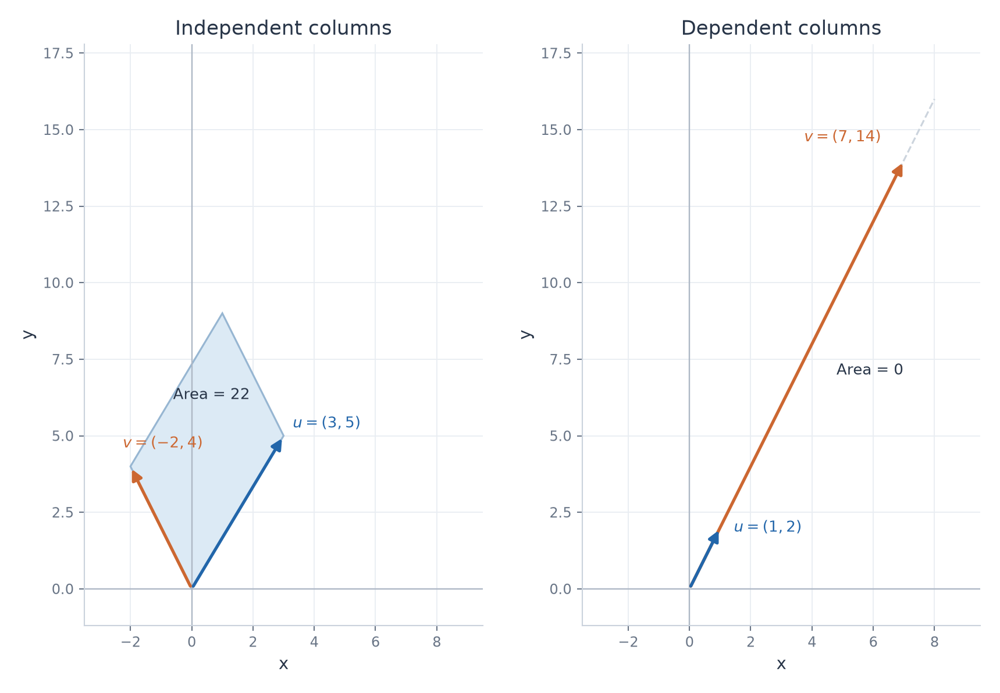

# Exercise 1 — Determinant of a 2×2 Matrix

[Exercise sheet](../../../exercises/1_Algebra/02_determinants_en.md)

## Problem

Compute

$$
\det
\begin{pmatrix}
3 & -2 \\
5 & 4 \\
\end{pmatrix},\qquad \det
\begin{pmatrix}
1 & 7 \\
2 & 14 \\
\end{pmatrix}.
$$

Which matrix is invertible? Justify your answer.

## Method

For a $2\times2$ matrix, use $\det A=ad-bc$. A square matrix is invertible exactly when its determinant is nonzero.

## Solution

Denote the first matrix by $A$ and the second by $B$.

$$
\det A=3\cdot4-(-2)\cdot5=12+10=22.
$$

$$
\det B=1\cdot14-7\cdot2=14-14=0.
$$

**Result**

$A$ is invertible because $\det A=22\ne0$. $B$ is singular because $\det B=0$.

The absolute determinant is the parallelogram area. Collinear columns collapse that area to zero.

## Verification

For $B$, the second row is twice the first row, which independently explains the zero determinant. For $A$, the proposed inverse satisfies

$$
A\left(\frac1{22}\begin{pmatrix}
4 & 2 \\
-5 & 3 \\
\end{pmatrix}\right)=\frac1{22}\begin{pmatrix}
22 & 0 \\
0 & 22 \\
\end{pmatrix}=I.
$$

This verifies invertibility directly.
