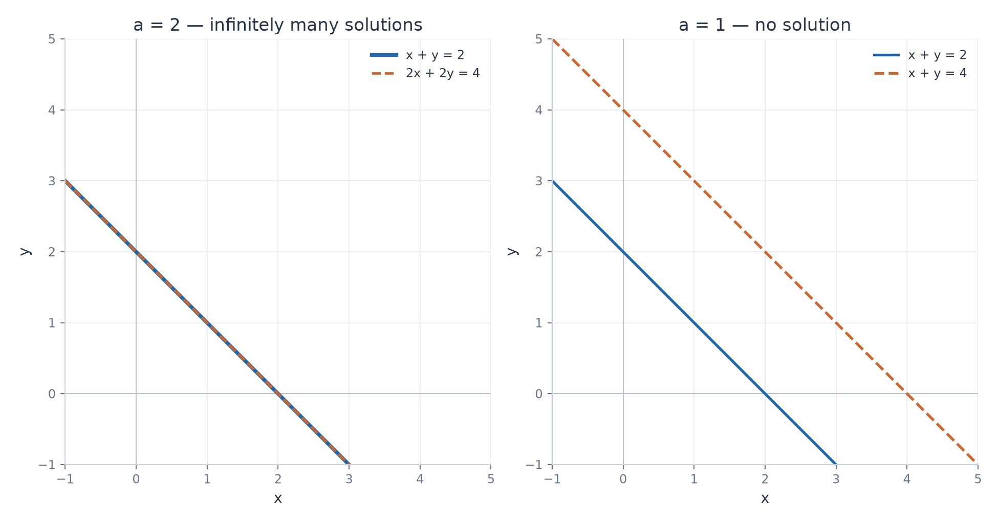

# Exercise 6 — A System with a Parameter — Which Cases Actually Occur?

[Exercise sheet](../../../exercises/1_Algebra/04_systems_of_equations_en.md)

## Problem

Analyze, depending on the parameter $a$, the system

$$
\begin{cases}
x+y=2, \\
ax+ay=4. \\
\end{cases}
$$

Among the three possibilities — exactly one solution, infinitely many solutions, no solution — determine which actually occur and for which values of $a$. If one type cannot occur, explain why.

## Method

Eliminate using $R_2\leftarrow R_2-aR_1$. This operation is valid for every real $a$, including $a=0$. Classify the resulting last row.

## Solution

### 1. Eliminate without dividing by the parameter

$$
\begin{pmatrix}
1 & 1 & \mid & 2 \\
a & a & \mid & 4 \\
\end{pmatrix}
\xrightarrow{R_2\leftarrow R_2-aR_1}
\begin{pmatrix}
1 & 1 & \mid & 2 \\
0 & 0 & \mid & 4-2a \\
\end{pmatrix}.
$$

### 2. Separate the cases

**Case $a=2$**

The last row is $0=0$, and the second original equation is twice the first. Only $x+y=2$ remains. Set $x=t$.

$$
(x,y)=(t,2-t),\qquad t\in\mathbb{R}.
$$

There are infinitely many solutions.

**Case $a\ne2$**

The last row requires $0=4-2a$, whose right-hand side is nonzero. The system has no solution. This also includes $a=0$, when the second original equation is $0=4$.

**Result**

| Parameter | Number of solutions | Reason |
| --- | --- | --- |
| $a=2$ | Infinitely many | One independent equation for two unknowns |
| $a\ne2$ | None | A contradictory row |
| Any real $a$ | Exactly one never occurs | The coefficient matrix always has only one pivot |

The coefficient rows are always dependent. Consistency can therefore give a free variable, but cannot give two pivots.

The figure illustrates $a=2$ and $a=1$. For $a=0$, the second equation is the contradiction $0=4$.

## Verification

For $a=2$, substitution of $(t,2-t)$ gives $t+(2-t)=2$ and $2t+2(2-t)=4$. For $a\ne2$, multiplying the first equation by $a$ gives $ax+ay=2a$, which agrees with the second equation only if $a=2$.
