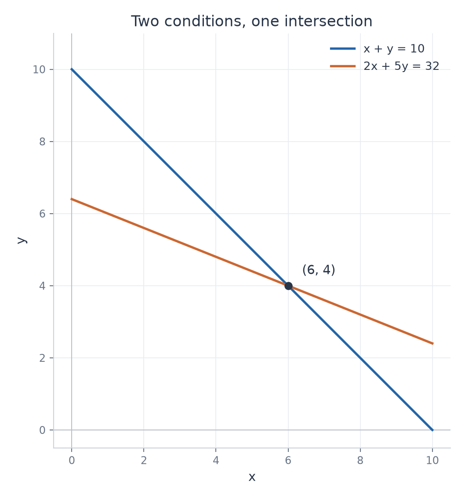

# Exercise 9 — A System from a Sum Condition

[Exercise sheet](../../../exercises/1_Algebra/04_systems_of_equations_en.md)

## Problem

Find numbers $x,y$ satisfying

$$
x+y=10,\qquad 2x+5y=32.
$$

Solve the system and explain geometrically why the solution is unique.

## Method

Use Gaussian elimination to solve the two linear conditions. Interpret the solution as the intersection of their lines.

## Solution

### 1. Elimination

$$
\begin{pmatrix}
1 & 1 & \mid & 10 \\
2 & 5 & \mid & 32 \\
\end{pmatrix}
\xrightarrow{R_2\leftarrow R_2-2R_1}
\begin{pmatrix}
1 & 1 & \mid & 10 \\
0 & 3 & \mid & 12 \\
\end{pmatrix}.
$$

The last row gives $3y=12$, so $y=4$. The first row gives $x=10-4=6$.

**Result**

$$
(x,y)=(6,4).
$$

### 2. Geometric interpretation

The two equations describe the lines

$$
y=10-x,\qquad y=\frac{32-2x}{5}.
$$

Their slopes are $-1$ and $-\frac25$, which are different. They meet at exactly one point, $(6,4)$. This explains the uniqueness geometrically.

Different slopes give one intersection. Both equations hold at the marked point.

## Verification

Substitute the coordinates into both original equations.

$$
6+4=10,\qquad 2(6)+5(4)=12+20=32.
$$

The coefficient determinant is $1\cdot5-1\cdot2=3\ne0$, confirming uniqueness algebraically.
