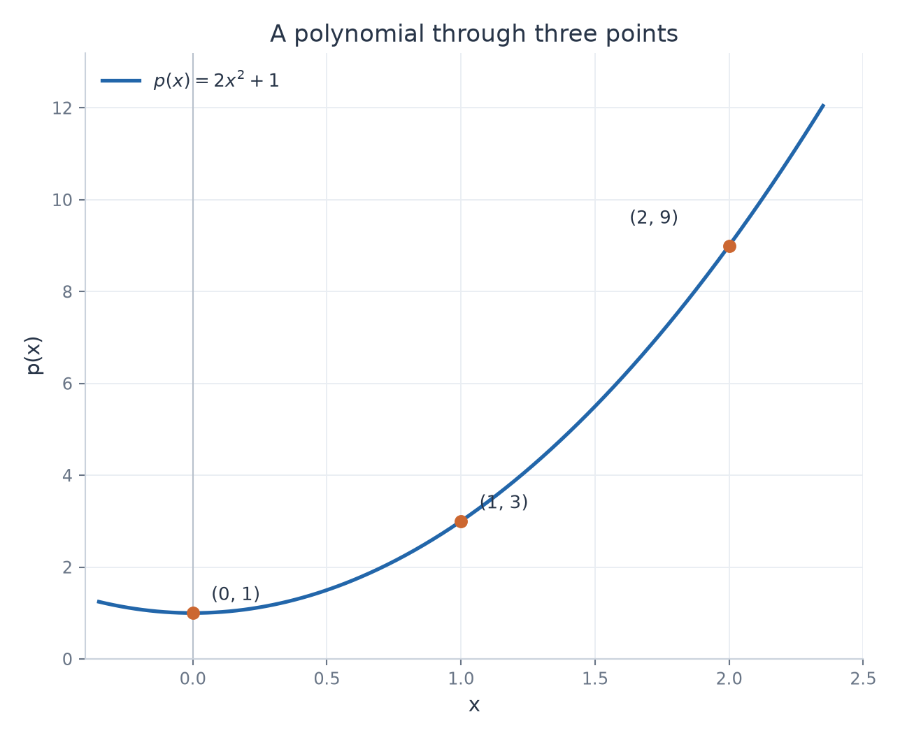

# Exercise 10 — A Polynomial Through Three Points

[Exercise sheet](../../../exercises/1_Algebra/04_systems_of_equations_en.md)

## Problem

Find a polynomial $p(x)=ax^2+bx+c$ whose graph passes through $(0,1)$, $(1,3)$, and $(2,9)$. Reduce the problem to a system of equations and check the result by substituting all three points.

## Method

Substitute each point into $p(x)=ax^2+bx+c$. The resulting equations are linear in the unknown coefficients $a,b,c$.

## Solution

### 1. Construct the coefficient system

The three point conditions give

$$
\begin{cases}
c=1, \\
a+b+c=3, \\
4a+2b+c=9. \\
\end{cases}
$$

In matrix form,

$$
\begin{pmatrix}
0 & 0 & 1 \\
1 & 1 & 1 \\
4 & 2 & 1 \\
\end{pmatrix}
\begin{pmatrix}
a \\
b \\
c \\
\end{pmatrix}=
\begin{pmatrix}
1 \\
3 \\
9 \\
\end{pmatrix}.
$$

### 2. Eliminate the coefficients

From the first equation, $c=1$. Substitution into the other equations gives $a+b=2$ and $4a+2b=8$.

$$
\begin{pmatrix}
1 & 1 & \mid & 2 \\
4 & 2 & \mid & 8 \\
\end{pmatrix}
\xrightarrow{R_2\leftarrow R_2-4R_1}
\begin{pmatrix}
1 & 1 & \mid & 2 \\
0 & -2 & \mid & 0 \\
\end{pmatrix}.
$$

Therefore $b=0$, $a=2$, and $c=1$.

**Result**

$$
p(x)=2x^2+1.
$$

The coefficient system has one solution, so these conditions determine a unique polynomial of degree at most two.

The three given points lie on the computed parabola.

## Verification

Check all three given points.

$$
\begin{aligned}
p(0)&=2(0)^2+1=1, \\
p(1)&=2(1)^2+1=3, \\
p(2)&=2(2)^2+1=9.
\end{aligned}
$$

The graph passes through $(0,1)$, $(1,3)$, and $(2,9)$.
